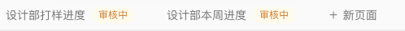
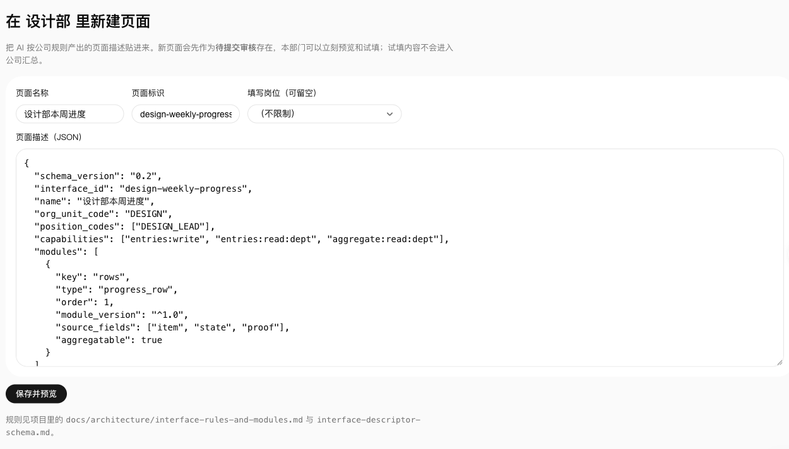
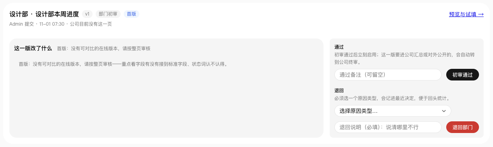

# 建一页、过一审（一页纸）

给真人试用：**一个部门管理员自己建一页 → 一个部门负责人初审通过**。全程点鼠标，不用装东西。

下面用设计部举例，页面叫「设计部本周进度」。

## 1. 先有部门和负责人（只做一次）

这一页要挂在某个部门下、还要有人签，所以先用平台管理员账号打开 `/setup`，按页面上的 1 → 3 做三件事：

1. **建部门**：部门代码 `DESIGN`、名称「设计部」、类型「部门」。
2. **建岗位**：至少一个「填写岗位」，例如 `DESIGNER`／设计师（写页面时会用到这个岗位代码）。这里建的是**组织里的岗位**，跟第 3 章页面表单里那个「填写岗位（可留空）」不是一回事——后者指「谁能填这一页」。
3. **建成员并分配岗位**：试用最好两个人（一个建页、一个签页），**但一个人也走得完**——2026-11-04 起审核**看权限不看作者**：勾了「部门负责人」的人能签自己提交的页，系统管理员能签任何部门、任何阶段。
   - **建页的人**：建一个成员，选「填写岗位」（如 `DESIGNER`）。
   - **审页的人**：再建一个成员，选个岗位，并**勾上「部门负责人」**——勾了，这个人才有权审这个部门的页面。

> 只想用一个账号：给他勾上「部门负责人」，他建完自己签，第 5 步同样能过。想要「别人审」的体验（也更接近真实组织）再建第二个成员。

> 没有部门负责人，这一页就没人能一审，会卡在第 5 步。若你手上的版本里 `/setup` 还没有这个勾选项：`local-trial.md` 用种子数据建的部门里，带 `*_LEAD` 岗位的人本来就有本部门的审页面权限，可以先拿它演示。

## 2. 进设计部工作台

登录后点左栏「**设计部**」。页面条最右边是「**＋ 新页面**」；如果这个部门还没有任何页面，那里显示的是「**＋ 新建页面**」，点进去是同一个地方。



## 3. 填三个名字，贴一段页面描述

- **页面名称**：设计部本周进度
- **页面标识**：`design-weekly-progress`（小写英文，别用中文）
- **填写岗位**：留空就行（留空＝部门里谁都能填）
- **页面描述（JSON）**：把下面整段贴进去

```json
{
  "schema_version": "0.2",
  "interface_id": "design-weekly-progress",
  "name": "设计部本周进度",
  "org_unit_code": "DESIGN",
  "position_codes": ["DESIGNER"],
  "capabilities": ["entries:write", "entries:read:dept", "aggregate:read:dept"],
  "modules": [
    {
      "key": "rows",
      "type": "progress_row",
      "order": 1,
      "module_version": "^1.0",
      "source_fields": ["item", "state", "proof"],
      "aggregatable": true
    }
  ],
  "fields": [
    {"key": "item",  "label": "事项", "type": "text", "required": true, "map_to": "title",    "aggregatable": true, "example": "秋1波主推款定稿"},
    {"key": "state", "label": "状态", "type": "enum", "required": true, "map_to": "status",   "aggregatable": true, "example": "进行中", "options": ["未开始", "进行中", "卡住了", "已完成"]},
    {"key": "proof", "label": "依据", "type": "text", "required": true, "map_to": "evidence", "aggregatable": true, "example": "定稿评审记录 10-30"}
  ],
  "status_map": {"未开始": "planned", "进行中": "in_progress", "卡住了": "blocked", "已完成": "done"},
  "rules": {"evidence_required": true, "blocked_requires_reason": true},
  "meta": {"author_position_code": "DESIGNER", "version": 1, "visibility": "department"}
}
```

**这是 AI 帮你生成的页面描述，整段贴进去就行，一个字都不用改。** 它只有三栏：事项、状态、依据。

填完点「**保存并预览**」（不是「保存」）。



## 4. 自己先试填一遍，再提交

预览里就能直接填内容试试（事项／状态／依据）。觉得没问题，点「**提交审核**」。

页面状态变成「待提交」/审核中。**这时候你填的东西只在本部门可见，不进公司汇总**，可以随便试、可以撤回。

## 5. 换负责人登录，初审通过

负责人怎么登录：`/setup` 建成员时给的那张一次性登录链接**只显示一次**（离开那页就没了）。丢了就在服务器上按员工编号重签一张：

```sh
oams issue-token --employee-code LEAD001
```

员工编号就是 `/setup` 建成员时填的那个（比如 `LEAD001`）——那一栏可留空，但留空了就只能用 `--member-id <uuid>`；两种写法签出来的令牌等价。

命令会**直接打出能点开的登录地址**，不用自己拼 `/login?token=`：终端里多一行「把这一行贴进浏览器就能登录：`http://127.0.0.1:8000/login?token=…`」，输出的 JSON 里也有一个 `login_url`。贴进浏览器即可。

地址里的站点前缀按三级取：命令行 `--base-url` → 环境变量 `OAMS_BASE_URL` → 本机默认 `http://127.0.0.1:8000`。你的服务不在 8000 上，就加 `--base-url http://127.0.0.1:<你的端口>`（或先 `export OAMS_BASE_URL=…`），打出来的地址才点得通。

换人时再签一张、点开新地址就行；想先退出，点右上角账号菜单里的「退出登录」。

负责人登录后点顶部「**页面审核**」，会看到一张卡片：**设计部 · 设计部本周进度**。两个按钮：

- 「**初审通过**」——通过后这页立刻能用；
- 「**退回部门**」——必须选一个原因类型、写一句哪儿不行。



如果这页要**对外公开**或**进公司汇总**，通过后会提示「**已转到公司终审**」，负责人这边的队列就清空了，等公司那边再签一次。

## 6. 卡住了去哪看

- **作者这边**：回「设计部」工作台，你那一页的标签上有「**待提交**」标记，说明还在等审核。
- **负责人这边**：审核页里没有这张卡，就是**不归你签**（可能已经转到公司终审了）。审核页最下面如果有一张「**别处还在等**」的表，最后一列「等谁签」会写着是部门初审还是公司终审——这张表只有平台权限的人能看到。

---

*这是演示站、演示数据，随便试，试坏了也不影响真实数据。*
